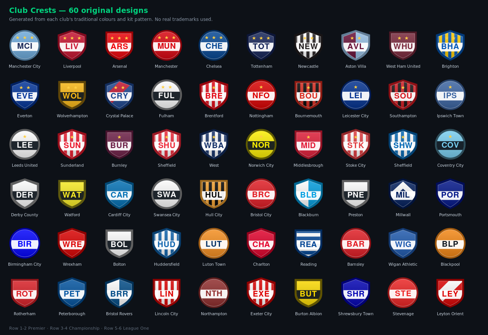

# 足球经理 · Football Manager Web

浏览器里的足球经理模拟游戏。**单文件、零依赖、不联网、手机可装**。

👉 **在线试玩：** https://Lynch715.github.io/football-manager-web/

## 最新修复

v64：赛季结束跳到新赛季时，按实际休赛天数补算设施升级与球场扩建工期；正常竣工，兼容原有存档。详见 [休赛期建设修复说明](休赛期建设修复说明.md)。

v63：青训新人不足半年或有效机会不足 12 场不做年度潜力升降评估；普通球员 23 岁开放全部成长空间，保留 23—27 岁的培养窗口，28 岁起温和收拢未兑现潜力。兼容旧存档。详见 [青训与成长修复说明](青训与成长修复说明.md)。

v62：点球大战读取罚球者与门将属性；停赛按赛事分别累计和执行；季末按实际休赛天数康复，未愈重伤及未服停赛延续。界面保持不变，兼容旧存档。详见 [比赛规则修复说明](比赛规则修复说明.md)。

v61：修复同日比赛被自动结算、赛季末附加赛被跳过、转会反复重试及培养出场统计。界面保持不变，兼容旧存档。详见 [游戏性修复说明](游戏性修复说明.md)。

v60：夏窗和冬窗最后一天的新报价先留给玩家处理，离开当天再关窗；兼容旧档。详见 [截止日新报价修复说明](截止日新报价修复说明.md)。

## 玩什么

- **五大联赛顶级联赛 96 家俱乐部**使用 2024/25 赛季真实球员姓名、EA FC 25 评分与队徽；其余联赛及后续再生球员继续由程序生成
- **回合制比赛引擎**：持球人依据自身属性、场上位置与防守压力，在传球 / 过人 / 传中 / 射门间做选择；越位、犯规、红黄牌、伤病、体能衰减实时结算
- **2D 俯视球场**：22 人按阵型与球的位置动态跑位，逐帧插值渲染，0.5×–8× 变速，随时换人与临场改战术
- **8 套阵型 + 4 条战术指令**（心态 / 节奏 / 逼抢 / 宽度），引擎真实读取这些数值
- **完整赛季循环**：38 轮联赛 + 6 轮足总杯，3 升 3 降含附加赛，多赛季存档
- **经营系统**：转会窗与球探情报、周训练重点、青训梯队、合同续约、工资与转会预算、董事会信心

## 引擎校准

按真实英超数据调参，500 场压力测试：

| 指标 | 本引擎 | 英超实际 |
|---|---|---|
| 场均进球 | 2.78 | ~2.8 |
| 射门 / 射正 | 27.4 / 10.1 | ~26 / 8.7 |
| 犯规 / 黄牌 | 18.3 / 3.0 | ~20 / 3.5 |
| 全场传球 | 922 | ~900 |

6 个赛季长跑下球员总量、年龄结构、能力分布与俱乐部财政均不发散。

## 手机

- 横屏优先，竖屏自动切底部导航 + 单栏布局，表格可横向滑动
- 支持「添加到主屏幕」，全屏运行、**断网也能玩**（Service Worker 离线缓存）

## 存档

进度不会自动保存。在「存档」页手动保存到浏览器，或导出 `.json` 文件长期保留。

## 队徽与球员资料

五大联赛顶级联赛的首赛季名单采用 **2024/25** 快照：球员姓名、位置、总评、潜力和单项能力来自 EA SPORTS FC 25 / SoFIFA 数据，96 枚队徽为同赛季历史素材并已嵌入离线页面。

这些真实资料和队徽只用于本机个人版本的球队识别；不应将含有这些素材的版本重新发布或用于商业用途。低级别联赛、欧洲其他球队及后续生成的球员仍使用程序生成的原创名称和队徽。

## 本地运行

不需要服务器，直接双击 `index.html` 即可（离线缓存与主屏安装功能需通过 http(s) 访问）。

## 许可

版权所有 © 2026 Lynch，保留所有权利。禁止下载、复制、商用、改编及 AI 抓取与训练，详见 `LICENSE`。俱乐部名称与球场名为真实存在的事实性信息，球员、数据、队徽均为虚构或原创。
